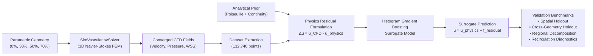

# HemoDyn-AI

[](https://github.com/z5rcnws7bz-eng/HemoDyn-Ai/releases)
[](https://www.python.org/)
[](https://opensource.org/licenses/MIT)
[](REPRODUCIBILITY.md)
[](tests/)

**HemoDyn-AI** is a reproducible computational hemodynamics and physics-guided machine learning (PGML) research framework for evaluating 3D blood flow in healthy and stenotic human arteries ($0\%$, $30\%$, $50\%$, and $70\%$ diameter constrictions). 

By coupling high-fidelity Navier-Stokes finite element simulations from [SimVascular](https://simvascular.github.io/) svSolver with gradient-boosted residual surrogate models, HemoDyn-AI achieves fast, physically consistent approximations of arterial velocity fields, pressure drops, and wall shear stress (WSS) distributions.

---

## 📌 Research Overview & Motivation

Arterial stenosis—pathological luminal narrowing caused by atherosclerotic plaque—disrupts cardiovascular hemodynamics. Local lumen constriction accelerates blood velocity, generates steep translesional pressure gradients, sharply elevates wall shear stress (WSS), and induces flow separation with recirculation vortices downstream.

Although 3D computational fluid dynamics (CFD) provides golden-standard numerical accuracy, its high computational burden limits its utility in urgent clinical decision-making and large cohort trials. Standard black-box machine learning models frequently suffer from severe out-of-distribution extrapolation errors in high-gradient regions such as the stenosis throat.

**HemoDyn-AI demonstrates that physics-guided residual learning outperforms purely data-driven surrogate models by enforcing mass conservation and Poiseuille/continuity scaling as an analytical prior.**

---

## 🔬 Methodology & Architecture



### 1. High-Fidelity CFD Modeling
- **Governing Equations**: Incompressible Navier-Stokes solved via stabilized finite elements in SimVascular svSolver.
- **Fluid Parameters**: Whole blood density $\rho = 1060\text{ kg/m}^3$, dynamic viscosity $\mu = 0.004\text{ Pa}\cdot\text{s}$.
- **Physiological Inflow**: Steady flow rate $Q = 1244\text{ mm}^3/\text{s}$ ($1.244\text{ mL/s}$) across a baseline $D_0 = 4.0\text{ mm}$ artery of length $L = 120\text{ mm}$.
- **Mesh Convergence**: Verified across coarse ($0.60\text{ mm}$), medium ($0.45\text{ mm}$), and ultrafine ($0.35\text{ mm}$) meshes.

### 2. Physics-Guided Residual Learning
Rather than predicting the complex 3D velocity field directly from geometry, the model predicts the **physical discrepancy residual**:

$$u(\mathbf{x}) = u_{\text{physics}}(\mathbf{x}) + f_{\text{ML}}(\mathbf{X})$$

where the analytical prior $u_{\text{physics}}$ enforces continuity and parabolic profile scaling:

$$u_{\text{physics}}(r, z) = \frac{2 Q}{\pi R(z)^2} \max\left(1 - \frac{r^2}{R(z)^2}, 0\right)$$

---

## 📊 Key Research Findings

### 1. Four-Case Hemodynamic Progression

| Case | Severity | Peak Velocity ($\text{mm/s}$) | Pressure Drop ($\text{Pa}$) | Mean Wall WSS ($\text{Pa}$) | Maximum Throat WSS ($\text{Pa}$) |
| :--- | :---: | :---: | :---: | :---: | :---: |
| **Healthy** | $0\%$ | $204.04$ | $86.22$ | $0.64$ | $0.68$ |
| **Mild Stenosis** | $30\%$ | $374.62$ | $109.95$ | $0.69$ | $2.25$ |
| **Moderate Stenosis** | $50\%$ | $786.77$ | $211.94$ | $0.72$ | $5.73$ |
| **Severe Stenosis** | $70\%$ | $2118.99$ | $1176.12$ | $1.08$ | $27.68$ |

### 2. 71.4% Error Reduction in the Stenosis Throat

When trained on Healthy and 30% cases and evaluated on an unseen 50% stenosis, the regional error breakdown shows:

| Anatomical Zone | Axial Interval ($z$) | Geometry-Only ML RMSE | Physics-Guided ML RMSE | Error Reduction |
| :--- | :---: | :---: | :---: | :---: |
| **Upstream** | $0 \le z < 50\text{ mm}$ | $0.88\text{ mm/s}$ | **$0.74\text{ mm/s}$** | $-15.7\%$ |
| **Approach** | $50 \le z < 55\text{ mm}$ | $14.12\text{ mm/s}$ | **$13.13\text{ mm/s}$** | $-7.0\%$ |
| **Stenosis Throat** | $55 \le z < 65\text{ mm}$ | $131.52\text{ mm/s}$ | **$37.55\text{ mm/s}$** | **$-71.4\%$** |
| **Post-Stenotic** | $65 \le z < 85\text{ mm}$ | $37.94\text{ mm/s}$ | **$37.54\text{ mm/s}$** | $-1.1\%$ |
| **Distal Recovery** | $85 \le z \le 121\text{ mm}$ | $3.86\text{ mm/s}$ | **$3.84\text{ mm/s}$** | $-0.5\%$ |

> **Takeaway**: Standard data-driven ML diverges significantly in the constricted throat ($131.52\text{ mm/s}$ error). Anchoring predictions to the analytical continuity prior constrains the solution, cutting throat error by **$71.4\%$**.

### 3. Cross-Geometry Holdout Generalization (Leave-One-Geometry-Out)

| Held-out Severity | Physics Baseline RMSE | Geometry-Only ML RMSE | Physics-Guided ML RMSE | PGML $R^2$ |
| :--- | :---: | :---: | :---: | :---: |
| **Healthy ($0\%$)** | $2.01\text{ mm/s}$ | $1.25\text{ mm/s}$ | **$1.12\text{ mm/s}$** | $0.9997$ |
| **Mild ($30\%$)** | $8.33\text{ mm/s}$ | $20.98\text{ mm/s}$ | **$16.51\text{ mm/s}$** | $0.9499$ |
| **Moderate ($50\%$)** | $23.30\text{ mm/s}$ | $29.21\text{ mm/s}$ | **$17.29\text{ mm/s}$** | $0.9621$ |

---

## 📁 Repository Structure

```text
HemoDyn-Ai/
├── CITATION.cff                      # Academic citation file format (v1.2.0)
├── CONTRIBUTING.md                   # Research collaboration guidelines
├── LICENSE                          # MIT open-source license
├── README.md                        # Master repository documentation
├── REPRODUCIBILITY.md               # Detailed scientific reproduction protocol
├── environment.yml                  # Conda / Mamba environment specification
├── requirements.txt                 # Pinned Python package dependencies
├── pyproject.toml                   # Standard Python packaging & pytest config
├── reproduce.sh                     # Automated one-command reproducibility script
│
├── hemodyn_ai_step1.py              # Step 1: Parametric geometry generation (STL/VTP)
├── hemodyn_ai_step2.py              # Step 2: Geometric QA & diameter verification
├── hemodyn_ai_step3_prepare_simvascular.py # Step 3: SimVascular mm-coordinate preparation
├── make_polished_stenosis_wss.py    # Publication WSS rendering script
│
├── scripts/                         # Research reproduction scripts
│   ├── build_hemodyn_ml_dataset.py  # Builds hemodyn_training_data.npz from CFD
│   ├── train_hemodyn_ml.py          # Trains PGML model with spatial holdout
│   ├── test_hemodyn_geometry_holdout.py # Leave-one-geometry-out cross-validation
│   ├── analyze_hemodyn_ml_regions.py    # 5-zone anatomical regional error analysis
│   ├── plot_hemodyn_ml_reverse_flow.py  # Recirculation & reverse-flow diagnostics
│   ├── visualize_hemodyn_ml_50pct.py    # 2D cross-section contour comparison
│   ├── create_ml_poster_panel.py        # Synthesizes publication/poster panels
│   ├── plot_four_case_velocity_slices.py # Longitudinal velocity slices
│   └── render_cfd_wss_3d.py             # 3D wall shear stress maps
│
├── tests/                           # Automated reproducibility test suite
│   └── test_reproducibility.py      # Automated pytest verification tests
│
├── data/                            # Geometry definitions & boundary surfaces
│   ├── geometries/                  # Canonical 0%, 30%, 50%, 70% VTP & STL files
│   ├── simvascular_mm/              # Rescaled models for SimVascular
│   └── stenosis_geometry/           # Remeshed templates with boundary face IDs
│
├── results/                         # Numerical metrics, trained models & data
│   ├── four_case_comparison/        # CFD benchmark summary CSV & plots
│   └── ml/                          # Extracted dataset (.npz), trained models (.joblib), CSVs
│
└── figures/                         # High-resolution scientific figures
    ├── poster/                      # Complete conference poster panel
    └── four_case_comparison/        # 3D WSS and longitudinal slice comparisons
```

---

## 🚀 Quickstart & Reproducibility Guide

### 1. Installation

```bash
# Clone the public repository
git clone https://github.com/z5rcnws7bz-eng/HemoDyn-Ai.git
cd HemoDyn-Ai

# Create virtual environment
python3 -m venv .venv
source .venv/bin/activate

# Install dependencies
pip install --upgrade pip
pip install -r requirements.txt
```

*(Alternatively, with Conda)*:
```bash
conda env create -f environment.yml
conda activate hemodyn-ai
```

### 2. Verify with Automated Test Suite

```bash
pytest tests/ -v
```

All 6 automated tests verify:
- Geometry manifold integrity and zero open edges
- Training dataset shapes (132,740 points across 3 geometries)
- Analytical Poiseuille/continuity physics equations
- Serialized surrogate model inference
- Benchmark metrics replication

### 3. One-Command Full Pipeline Reproduction

```bash
./reproduce.sh
```

---

## 📜 Citation

If you use HemoDyn-AI's code, models, datasets, or CFD benchmarks in your research, please cite:

```bibtex
@software{ron2026hemodyn,
  author       = {Jace Ron},
  title        = {{HemoDyn-AI: Physics-Guided Machine Learning and CFD for Arterial Stenosis Hemodynamics}},
  year         = {2026},
  publisher    = {GitHub},
  version      = {v1.0.0},
  url          = {https://github.com/z5rcnws7bz-eng/HemoDyn-Ai}
}
```

---

## 👤 Author & Affiliation

- **Jace Ron**
- Health Sciences / Biomedical Engineering Research
- Temple University, Philadelphia, PA
- Contact: [jace.roman@temple.edu](mailto:jace.roman@temple.edu)
- GitHub: [@z5rcnws7bz-eng](https://github.com/z5rcnws7bz-eng)

---

## 📄 License

This project is licensed under the **MIT License** — see the [LICENSE](LICENSE) file for details.

